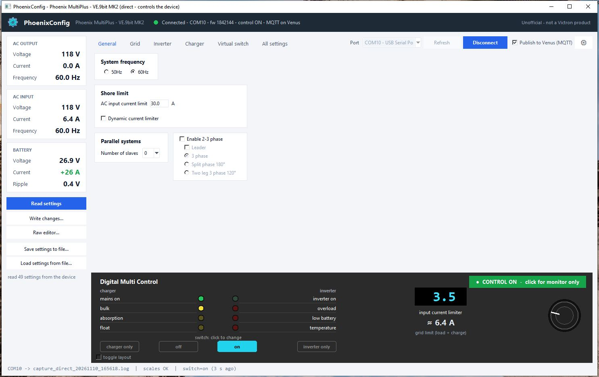
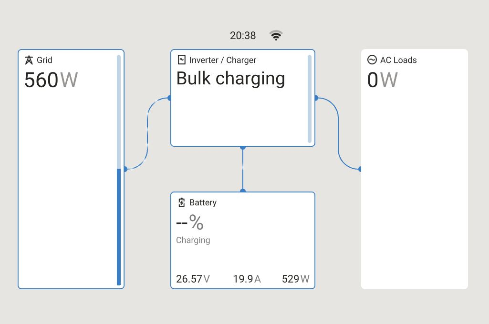
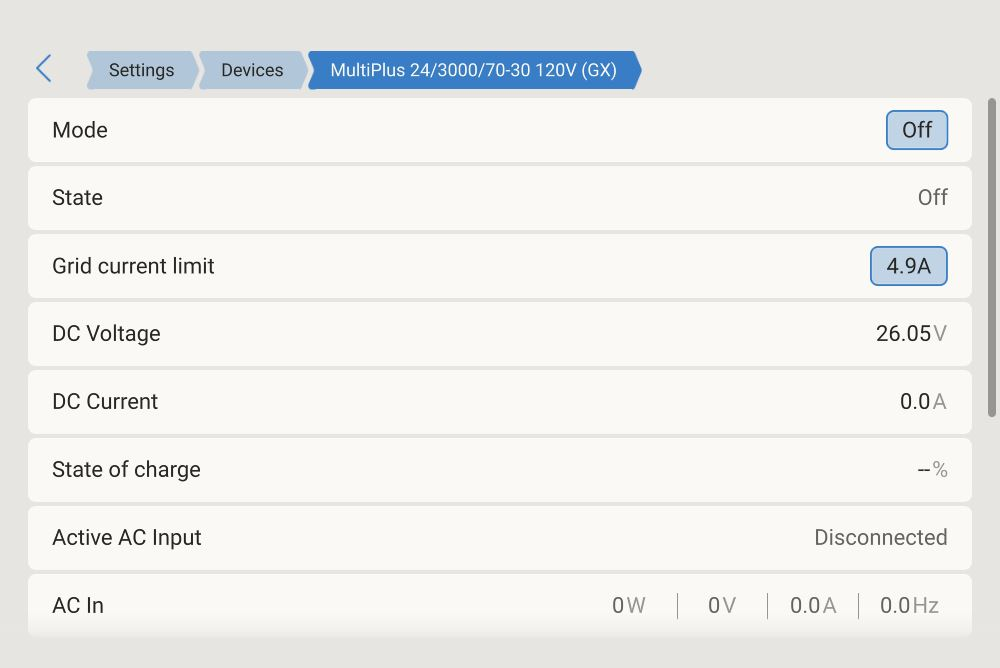
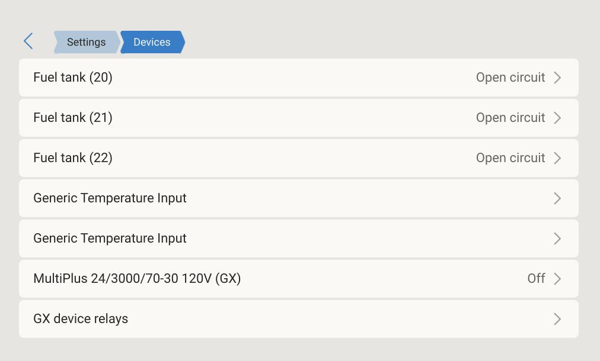

# Phoenix MultiPlus VE.9bit MK2 Link

Bring a **pre-VE.Bus Victron Phoenix MultiPlus** (VE.9bit protocol) onto a **Venus GX / Cerbo GX** like a modern
VE.Bus unit, and configure, monitor and control it from a PC.

Victron's GX software does not support these old units. Here the MK2 interface plugs **directly into the GX**
(USB-RS232 adapter, no PC needed) and a service on the GX makes the MultiPlus a normal `vebus` device: Venus and VRM
show AC in/out, battery, charge state, alarms and history, and can optionally set the **input current limit and
Mode** (on / off / charger only / inverter only) from the GX, Remote Console or VRM. See
[docs/venus-gx-service.md](docs/venus-gx-service.md).

> **Not a Victron product.** This is an independent, unofficial project. It is not affiliated with, endorsed by or
> supported by Victron Energy. Using it can change the configuration of a power device. Read [Safety](#safety) first.



## What is included

| Component | What it does | Runs on |
|---|---|---|
| **PhoenixConfig** (`mk2_panel.py`) | Desktop app: live measurements, Digital Multi Control (LEDs, switch, input current limiter), read/edit/write settings, settings backup to a file, optional publishing to Venus over MQTT, built-in emulator | Windows PC (Python, Tk) |
| **MQTT bridge** (`mk2_mqtt.py`) | Publishes the device to a Venus GX over the LAN (MQTT). Venus shows it as a VE.Bus inverter/charger; current limit and Mode can optionally be controlled from Venus / VRM | Built into PhoenixConfig, or standalone on any PC |
| **GX service** (`mk2_gx.py`) | Headless version of the bridge that runs **on the Venus GX itself**, with the MK2 plugged into the GX over a USB-RS232 adapter. No PC needed | Venus OS (daemontools service) |
| **Emulator** (`mk2_emu.py`) | A MultiPlus + MK2 emulator built from captured traffic. Lets you try everything (also MQTT to Venus) without any hardware | Built into PhoenixConfig (`emulator` port), or standalone on a com0com pair |
| Communication monitoring tools | `mk2_proxy.py`, `mk2_watch.py` and log analysis scripts used to work out the protocol ([docs/monitoring-tools.md](docs/monitoring-tools.md)) | PC |

The MK2 interface can only have one host at a time: use **either** PhoenixConfig on a PC **or** the GX service.

## Supported hardware

Tested on exactly one system. Anything else is untested; see [docs/hardware.md](docs/hardware.md).

| | Tested |
|---|---|
| Device | Victron Phoenix MultiPlus 24/3000/70-30 **120 V**, pre-VE.Bus (VE.9bit), firmware **1842144** |
| Interface | Victron Interface **MK2.2b** – VE.Bus to RS232 (ASS030120210), RS232 DB9 to the PC, RJ45 to the device |
| PC serial | Built-in COM port; FTDI US232R USB-RS232 adapter |
| Venus | Venus GX, Venus OS v3.85, with [dbus-mqtt-devices](https://github.com/freakent/dbus-mqtt-devices) v0.9.0 |

**You need, for real use:** the MK2.2b interface, plus a PC with an RS232 port or a USB-RS232 adapter. For the GX
service a USB-RS232 adapter is required (the GX has no RS232 port). FTDI-based adapters are recommended.

**No hardware at all?** PhoenixConfig has a built-in emulator. It can also publish to a Venus over MQTT as a
separate device named "EMULATOR (PhoenixConfig)". See [docs/emulator.md](docs/emulator.md).

230 V units: the device profile exists but is deliberately disabled until someone tests it.

## Quick start (PC)

```bat
pip install -r requirements.txt
copy mk2.example.toml mk2.toml
python mk2_panel.py
```

Pick the port of your MK2 (or `emulator`) in the port list, press **Connect**, then **Read settings**.
Connect is **monitor only** by default: nothing that changes the device is sent until you click the yellow
**Monitor only - click to enable control** button on the Digital Multi Control (asked once, then remembered).
Details: [docs/phoenixconfig.md](docs/phoenixconfig.md).

Requirements: Python 3.11+ (tested 3.14 on Windows), `pyserial`, `paho-mqtt` (see `requirements.txt`).
Install Python from python.org and tick "Add python.exe to PATH".

**Starting the app on Windows:** the command is `python mk2_panel.py` (or `py -3 mk2_panel.py`), not `python3`.
Or double-click `PhoenixConfig.bat`, which tries `python` first and then `py -3`, and waits for a key if the start
fails so that the error message stays visible. Linux and macOS use `python3`, but the app is only tested on Windows.

## Documentation

- [docs/hardware.md](docs/hardware.md): what hardware is assumed and how to connect it
- [docs/phoenixconfig.md](docs/phoenixconfig.md): the desktop app
- [docs/mqtt-bridge.md](docs/mqtt-bridge.md): showing the device on Venus over the LAN
- [docs/venus-gx-service.md](docs/venus-gx-service.md): running the bridge on the Venus GX, installation
- [docs/emulator.md](docs/emulator.md): testing without hardware
- [docs/configuration.md](docs/configuration.md): `mk2.toml` reference
- [docs/protocol.md](docs/protocol.md): the MK2 / VE.9bit protocol findings (commands, settings, flags, LED word)
- [docs/methodology.md](docs/methodology.md): how the protocol was worked out and verified
- [docs/monitoring-tools.md](docs/monitoring-tools.md): the communication monitoring and analysis tools
- [docs/development.md](docs/development.md): tests, packaging a release

## Screenshots

<p>
  
  
</p>
<p>
  
</p>

## Safety

**This software can change the configuration and the operation of a real inverter/charger connected to mains
and batteries. You use it at your own risk.** It is provided "as is", without warranty of any kind (see
[LICENSE](LICENSE)). Wrong settings or commands can damage batteries or equipment, cut the power to loads, and
may affect the warranty of your device.

- **Monitor only by default.** Opening a connection (PhoenixConfig, MQTT bridge, GX service) sends no current
  limit and no switch command. Control is switched on deliberately: the control button on the Digital Multi Control
  in PhoenixConfig (confirmed once, then remembered until you switch it off), or
  `[control] enabled = true` in `mk2.toml`. Remote control from Venus/VRM needs both that and its own
  `allow_*` setting, and is off by default in every installation method.
- **Firmware lock.** Writing settings, reset and control work only on the verified firmware (1842144). On any other
  firmware the program is read-only (read settings, monitor). `--allow-unknown-firmware` overrides this on purpose.
- The program only sends MK2 commands from a fixed whitelist. Settings are written only through a preview,
  validation (device limits plus extra safety limits), write and read-back check.
- **A write chain stops at the first failed write** (no acknowledgement or a read-back mismatch). The remaining
  settings are not written, the device is marked as partly written, and no reset is offered. Read the settings
  again and check them.
- **Settings writes go to the device EEPROM** and survive power cycles. **Switch and current limiter** commands are
  runtime (RAM) controls and are repeated every 10 s while control is on.
- Protected flag bits (Flags0 bits 9, 10, 12 "not promoted", bit 15) are always kept from the device value.
- Charge current is limited (default max 45 A, configurable lower only). A warning is shown for absorption/float
  voltages above LiFePO4 limits (configurable).
- Changing **Mode** (switch) from Venus or VRM switches the load and mains. It is off by default.
- **AC power on Venus/VRM is an estimate.** The device reports AC voltage and current only. The published power is
  U × I × `power_factor` (default 1.0 = apparent power VA, an upper bound), so AC power and VRM energy totals
  can read high. DC (battery) power is measured.
- **Network.** MQTT to the Venus is unencrypted (port 1883) and the program can control a real device. Use it only
  on a trusted, closed local network, never exposed to the internet. A remembered MQTT password is stored in
  plain text in `mk2_panel_state.json`.
- Keep a settings backup (**Save settings to file**) before writing anything.

Security issues: see [SECURITY.md](SECURITY.md).

## How it was made

The protocol of this old firmware is mostly undocumented. It was worked out by monitoring the serial traffic of
the official configuration software on a virtual serial port pair (com0com) with `mk2_proxy.py`, and by testing
the findings against the emulator and the real device. The monitoring tools and the emulator are included.

## License

MIT, see [LICENSE](LICENSE). Copyright (c) 2026 Juho Jalava.

Victron, MultiPlus, Phoenix, VE.Bus, Venus GX and Cerbo GX are trademarks of Victron Energy B.V., used here only to
describe compatibility.
